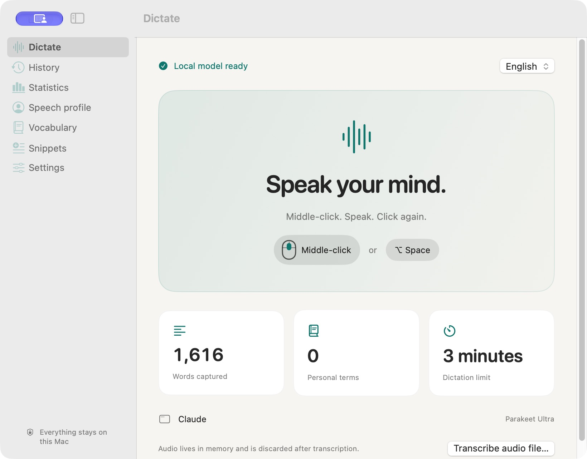
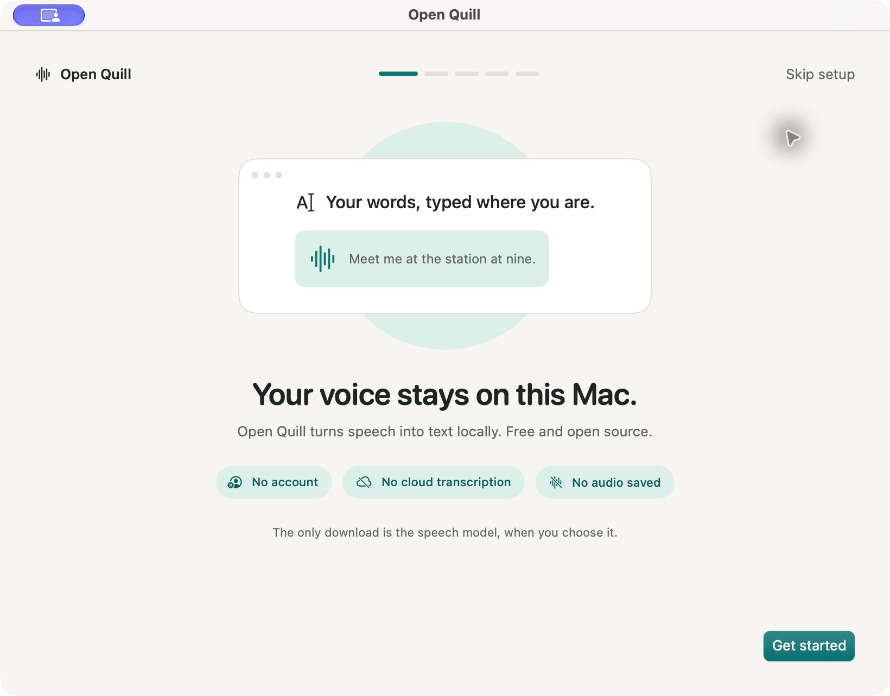
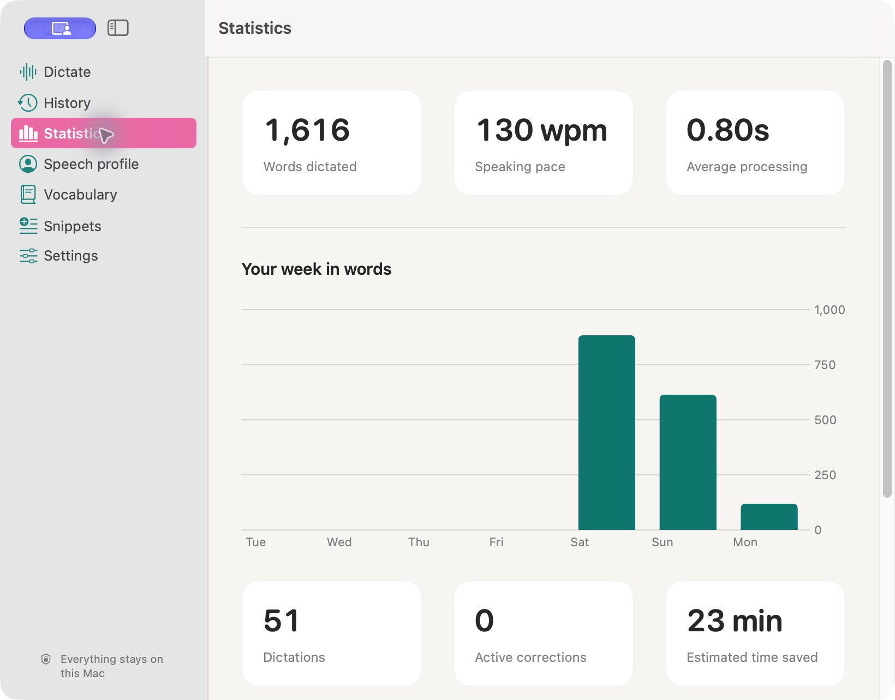

# Open Quill

Free, open-source dictation for Mac. Speak into any supported text field, with speech recognition and correction learning running locally.

**Apple silicon · macOS 14+ · MIT licensed**

## Dictate anywhere

Middle-click, speak, then middle-click again to insert your text. **Option-Space** is the default keyboard shortcut; **Escape** cancels.

- Live transcript preview and configurable shortcuts.
- Personal vocabulary learned from corrections in the destination app.
- Spoken snippets and optional on-device AI cleanup.
- Per-app preferences, local history and speech statistics.
- Microphone selection, audio muting, adjustable recording limits and quiet-pause stopping.

## Screenshots



<details>
<summary>Browse setup and statistics</summary>

**Setup**



**Statistics**



</details>

## Get started

Build with **Xcode / Swift 6.2+**:

```sh
./scripts/build-app.sh
open "dist/Open Quill.app"
```

Setup guides you through permissions, a free model download and a private practice field. Start with **Parakeet Ultra** for fast dictation in 25 languages, including English and Dutch / Flemish. Choose **Whisper** for its 100-language catalog. Accuracy varies by language and accent.

This is an early source release; a notarized download is not yet available.

## Private by default

No account, subscription, API key, telemetry or cloud transcription. After model setup, dictation works offline. Recordings stay in memory; saved transcripts and vocabulary stay on your Mac.

AI cleanup requires macOS 26+ and Apple Intelligence. Automatic Enter can submit messages; leave it off to learn from draft corrections.

[Development and troubleshooting](docs/DEVELOPMENT.md) · [Design](docs/DESIGN.md) · [Model credits](THIRD_PARTY_NOTICES.md) · [License](LICENSE)

Open Quill is independent of OpenAI and Wispr Flow.
